  

  
  
  

### ./about
B.Tech CSE (AI/ML) student building LLM apps, AI agents, and ML systems. I ship fast at hackathons and turn the best ideas into real projects.

### ./focus
`llm apps` `ai agents` `multi-agent systems` `machine learning` `developer tools`

### ./builds
| project | what it is |
|---|---|
| [intentstore](https://github.com/shikhon-rahaman/intentstore) | LLM-powered semantic storage intelligence engine |
| [nexus](https://github.com/shikhon-rahaman/nexus) | AI Linux operations assistant using natural language |
| [orion-space-ai](https://github.com/shikhon-rahaman/orion-space-ai) | multi-agent system analyzing NASA & NOAA data for mission risk |
| [ai-health-guardian](https://github.com/shikhon-rahaman/ai-health-guardian) | AI-powered health risk detection |
| [callflow](https://github.com/shikhon-rahaman/callflow) | universal AI phone agent platform for small businesses |

### ./stack

  

### ./activity

